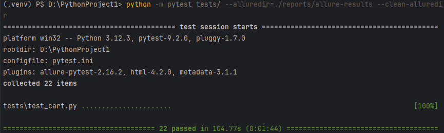
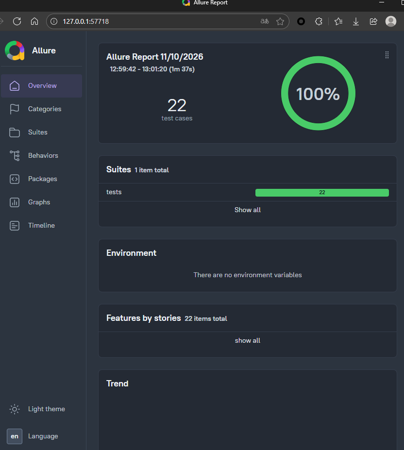
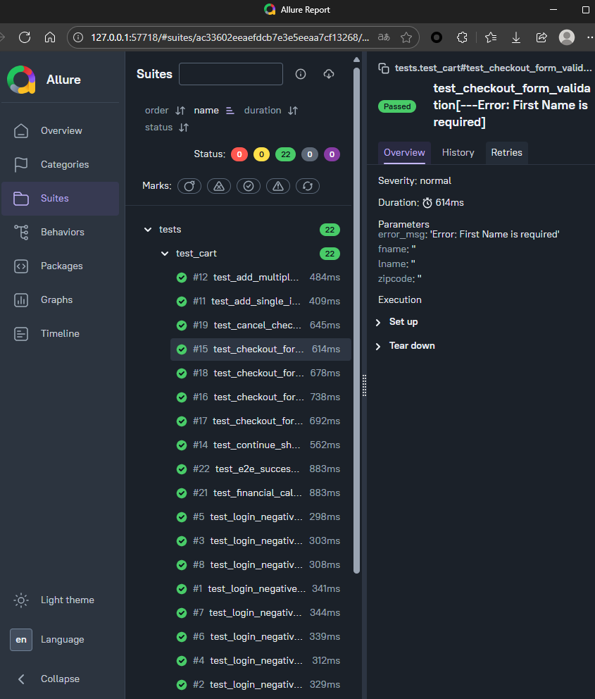

# 电商平台 Web UI 自动化测试框架 (SauceDemo)

## 📖 项目简介
本项目基于 **Python + Selenium + Pytest**，采用 **POM (Page Object Model)** 设计模式，针对 SauceDemo 电商平台实现从“用户鉴权”到“财务结算”的端到端（E2E）全链路深度自动化测试。

## 🛠️ 技术栈
- **语言**：Python 3.12
- **UI 测试工具**：Selenium WebDriver
- **测试框架**：Pytest
- **报告引擎**：Allure

## 🎯 核心业务覆盖与测试难点 (26+ 深度用例)
1. **登录鉴权矩阵**：覆盖正常登录、密码错误、账号锁定、空值校验等多角色多维度异常拦截测试。
2. **商品与购物车联动**：多维度价格排序校验、多商品动态加购/移除，验证前端购物车角标与数据的实时联动。
3. **财务级深度断言**：在结算环节，不仅校验流程流转，更抓取页面 DOM 数据，严格校验“**订单总价 = 商品小计 + 税费**”，确保金额计算精度零误差。
4. **异常流阻断**：验证表单必填项（姓名、邮编）缺失时的前端拦截与报错提示。

## 📁 目录结构
```text
├── pages/          # POM 页面对象层（封装页面元素与操作）
├── tests/          # 测试用例层（业务断言与参数化）
├── pytest.ini      # Pytest 配置文件（解决模块导入问题）
└── README.md
```


## 📊 测试成果展示

### 1. Allure 测试报告总览


### 2. 核心业务用例详情


### 3. 财务级断言执行日志



